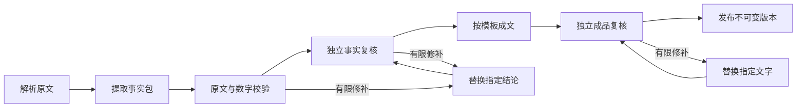

# 执行与数据架构

## 一次解读

1. API 核对登录与工作空间成员资格，保存论文记录、阅读对象和 `queued` job。任务快照固定模板版本、skill 与模型的公开参数，不含 API Key。
2. 常驻 worker 在 PostgreSQL 事务中领取符合团队配额的任务，生成租约 token，定期续租。每个 attempt 使用独立临时目录。
3. Worker 确认排队时模型配置与当前配置一致，再解密使用密钥；配置过期的任务失败，显式重试使用当前模型快照。读取请求在实际连接时执行网络地址策略。
4. 默认 `guided` 模式由 Python `GuidedWorkflow` 编排。每个模型阶段启动独立 Node/Pi runner，通过 stdin 传入该阶段必要输入和内存凭据；stdout 仅承载 JSONL 事件与工具 RPC。`native` 模式保留完整 skill 会话。
5. 来源工具获取全文。ljg-paper 优先 arXiv HTML，再尝试 PDF；DeepPaperNote 保留其 PDF 原生流程。下载固定到校验后的 IP，重定向逐跳检查。相关论文最多三篇，全文覆盖分别记录。
6. Guided 读取所选 skill 的指导并提取结构化事实包，每项包括结论、实验条件、原文证据与依据类型。Host 校验引用位置和数字比较方向，再启动独立事实复核；必要时只替换有问题的事实。Native 则执行原生写作、脚本检查和独立复核，保留实际原生产物。
7. Guided 成文阶段读取已核验事实包与双模板，不默认携带整篇原文或历史工具轨迹。独立成品复核检查事实覆盖、模板、比较条件和推断标签；必要时用精确匹配的局部补丁修订，再次复核。每类修补都有次数上限。
8. Worker 再核对全文覆盖、证据摘录、引用 ID、产物路径及可信流程完成记录。原生检查只适用于 native，guided 明确记录未请求完整原生流程。锁定 reading 并再次确认租约后，发布新的不可变 revision，将产物放入团队存储。

完整阶段输入采用保守的上下文大小检查；当前尚未实现任意长论文的分块汇总。超出窗口时明确失败，不静默裁掉后半篇。结构化协议与预算详见 [workflow-v2.md](workflow-v2.md)。

## 持久性与并发

PostgreSQL 保存任务、状态事件、尝试次数、租约、用量、模板版本与结果。内存进程只负责当前执行。任务 API 支持取消、显式重试及 SSE 事件重放；浏览器也可以轮询状态。

领取任务使用事务与锁，限制全局以及每个工作空间的并发；结果发布带租约 fencing。旧进程即使在失去租约后完成，也不能发布覆盖结果。修订使用 reading 行锁，拒绝基于过期版本创建新修订，拒绝同一 reading 的并发写入。

Worker 正常退出时停止子进程并保留可恢复材料；异常退出依靠租约过期恢复。Guided 阶段完成后保存 host 检查点，并在持有租约的数据库记录中锚定输入、输出和来源哈希；模型没有写入这些文件的工具。恢复和显式重试检查团队、reading、内容与规则版本，只复用输入一致且未被改动的已完成结果。未完成的阶段重新执行，已消耗的模型用量仍计入记录。远端模型请求未必能撤回已经计费的计算。

修订先判断是否涉及事实变化。只改表达时，可复用兼容父版本的事实包和真实复核报告；新增事实或比较时重新提取与核验。模板变化影响成文及后续复核，来源、模型或规则变化会使相应缓存失效，原版本始终保留。

每次尝试默认最多 160 次工具调用，通过 `PAPER_READER_MAX_TOOL_CALLS` 在 10–500 之间配置，另有独立的任务总超时。额度包含原生阅读、独立复核与产品生成，较长流程需要为全部阶段保留余量。工具额度耗尽立即中断外层 agent 和嵌套独立复核会话，保留明确失败原因，不允许模型靠重复失败的工具调用继续循环。

数据库和存储必须配套备份。管理脚本暂停本实例 API 与 worker 后执行逻辑数据库备份，复制 storage 与 config，再恢复原本运行的服务。目标恢复路径必须为新目录。

## 多租户边界

工作空间是数据与模型连接的租户边界。平台管理员管理账号与工作空间，团队角色决定团队内权限；平台管理员身份不自动授予另一个团队的文档访问权限。API 资源查询、任务、文件下载和 SSE 均检查当前成员资格。

凭据使用 Argon2 密码哈希、哈希 session token、Fernet 加密模型 API Key。Secret 不放入 job 快照、前端响应、产物或日志。Cookie 同源使用，写请求校验 Origin；HTTPS 部署启用 Secure Cookie 并配置 public origin。

Pi 每次使用独立的内存认证、模型目录、设置和会话，不加载宿主的全局 agent 配置、扩展、shell 或任意文件工具。脚本只允许打包的固定上游入口及经过验证的参数。模型输入和论文内容均不能扩大工具权限。

脚本执行目前是**固定可信脚本的受限执行接口**。可用内核使用 Landlock；当前验证宿主为 Linux 5.10，使用 Python 文件访问审计及 seccomp 禁网等限制。它不是任意第三方代码的通用安全沙箱，因此本版不提供用户上传任意 skill 的能力。

## 来源与质量语义

`succeeded` 表示本次实现要求的检查通过；它不是论文结论正确或模型绝不会出错的证明。`partial` 表示有可读结果但检查/来源覆盖仍有缺口；`failed` 表示没有通过必需流程。

原文证据验证确认摘录可以定位到保留的来源，并检查引用关系；它无法仅靠字符串匹配证明推理正确、实验公平或外部论文设置可比。这些由独立模型复核与人工阅读评估补充。推断与外部材料必须显式标记，不能把作者解释、系统归纳和已证明事实混为一类。

对于“以后肯定不这样做”的经验，模板要求写明负面效果的实验条件和边界。只有一篇论文的负结果，不能自动推广成整个方法方向无效；跨论文比较必须指出任务、基座模型、训练数据与预算是否一致。

## 扩展方式

增加 engine 时保留 worker 的租约、权限、来源与发布边界，实现同一单任务 JSONL 契约即可。当前只有 Pi adapter；没有伪装为可选项的 Codex、dsh 等实现。

增加 skill 需要固定上游版本、许可证、文件校验、获取原文方式、原生检查门槛、产物格式和兼容说明，并在相同论文与模型组合上回归。用户模板作用于产品层。Guided 明确只采用 skill 阅读指导；native 继续执行原有必需步骤。修改任意上游检查必须作为适配变化记录，不能声称原始检查已通过。
